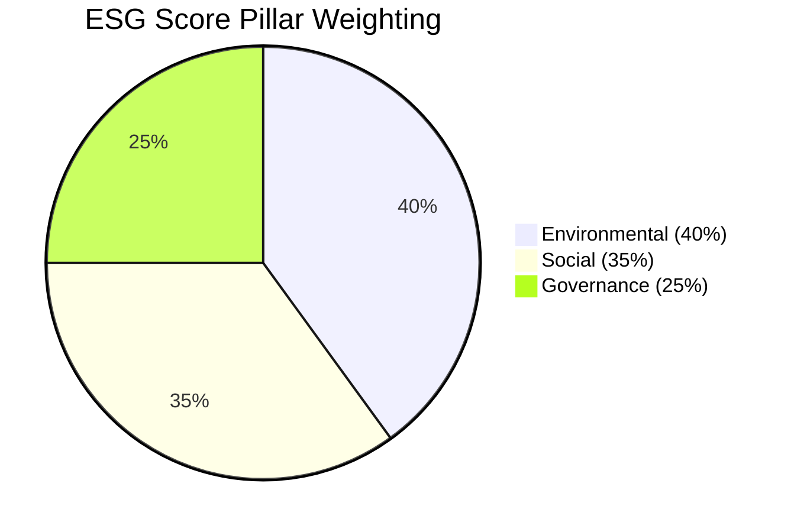
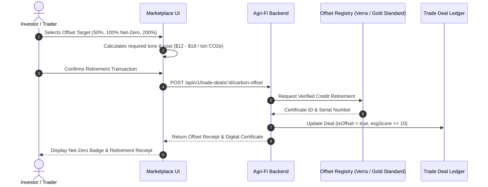

# Sustainability Tracking & Carbon Footprint Calculation Methodology

> **Agri-Fi Platform Specification**  
> **Status:** Production / Implemented  
> **Standards Alignment:** GHG Protocol Corporate & Scope 3 Standard, ISO 14064, GLEC Framework v3.0, DEFRA 2026 Emission Conversion Factors, SFDR (Articles 8 & 9), GRI 13 (Agriculture, Aquaculture and Fishing Sector 2022), SASB FB-AG.

---

## 1. Executive Summary & Objectives

The Agri-Fi Sustainability Tracking System provides rigorous, verifiable carbon accounting and ESG score aggregation across agricultural trade deals. By quantifying greenhouse gas emissions (GHG) across transportation, storage, and processing, displaying certified eco-labels, and providing institutional-grade ESG disclosure reports, Agri-Fi empowers environmentally conscious investors to deploy capital into verifiably sustainable agricultural supply chains.

### Key Capabilities
- **Cradle-to-Gate Carbon Accounting:** Algorithmic calculation of $CO_2$ equivalent ($CO_2e$) emissions for logistics, storage facilities, and primary crop processing.
- **Aggregated ESG Scoring:** Quantitative aggregation of Environmental (40%), Social (35%), and Governance (25%) metrics into a standardized 0–100 score and rating tiers (AAA to CCC).
- **Eco-Certification Transparency:** Digital verification and display of USDA/EU Organic, Fairtrade, Carbon Neutral (PAS 2060), Rainforest Alliance, and Non-GMO certifications.
- **ESG Deal Discovery & Comparison:** Multi-criteria filtering and side-by-side deal comparisons with automated highlighting of lowest-emission trade corridors.
- **Decarbonization Recommendations:** Machine-generated suggestions for modal shifts (e.g., road-to-rail or sea freight) and lower-carbon agricultural alternatives.
- **Institutional ESG Reporting:** Generation of SFDR/GHG Protocol compliant reports with automated Scope 1, 2, and 3 breakdowns and CSV exports.
- **Verified Carbon Offset Retirement:** In-app retirement of certified carbon credits (Gold Standard, Verra VCS) enabling trade deals to achieve certified Net-Zero or Climate-Positive status.
- **Platform Analytics:** Real-time dashboards tracking cumulative platform carbon reduction, offset volumes, and ecological impact equivalents.

---

## 2. Greenhouse Gas Accounting Methodology

Agri-Fi calculates emissions in alignment with the **GHG Protocol Corporate Value Chain (Scope 3) Standard** and the **Global Logistics Emissions Council (GLEC) Framework v3.0**.

### 2.1 Scope Demarcation in Agri-Fi Trade Deals

| GHG Protocol Scope | Agri-Fi Deal Component | Boundary Description |
| :--- | :--- | :--- |
| **Scope 1 (Direct)** | Primary Processing & Farm Operations | Direct stationary combustion and fugitive emissions at aggregation centres and processing facilities under operational control. |
| **Scope 2 (Indirect)** | Storage & Warehousing Electricity | Grid and purchased thermal energy consumption for grain elevators, climate-controlled warehousing, and drying facilities. |
| **Scope 3 (Value Chain)** | Upstream & Downstream Transportation | Well-to-Wheel (WTW) freight transport emissions across road, rail, maritime, and air corridors between farm origin and delivery destination. |

---

### 2.2 Mathematical Formulas

The total carbon footprint of a trade deal ($E_{\text{total}}$) is calculated as:

$$E_{\text{total}} = E_{\text{transport}} + E_{\text{storage}} + E_{\text{processing}}$$

Where all emissions are expressed in kilograms of carbon dioxide equivalent ($\text{kg } CO_2e$).

#### A. Transportation Emissions ($E_{\text{transport}}$)
Transportation emissions follow the ton-kilometer ($t\cdot km$) activity model:

$$E_{\text{transport}} = d \times W \times EF_{\text{mode}}$$

- $d$ = Transit distance in kilometers ($\text{km}$) between pickup origin and destination.
- $W$ = Cargo weight in metric tons ($\text{tons}$).
- $EF_{\text{mode}}$ = Well-to-Wheel emission factor per ton-km ($\text{kg } CO_2e / (t\cdot km)$) sourced from DEFRA/GLEC:

| Freight Mode | Emission Factor ($EF_{\text{mode}}$) | Reference Standard |
| :--- | :--- | :--- |
| **Maritime (Sea Freight)** | `0.0161 kg CO2e / t·km` | Bulk carrier / Container ship average |
| **Rail Freight** | `0.0278 kg CO2e / t·km` | Electric / Diesel hybrid European/Global average |
| **Road Freight (Heavy Goods)** | `0.0962 kg CO2e / t·km` | Rigid/Articulated >32t diesel truck |
| **Air Freight** | `0.6024 kg CO2e / t·km` | Dedicated air cargo short/long-haul average |

#### B. Storage Emissions ($E_{\text{storage}}$)
Storage facility emissions account for storage duration and facility renewable energy penetration:

$$E_{\text{storage}} = \left(\frac{t_{\text{days}}}{30}\right) \times W \times EF_{\text{storage}} \times (1 - R_{\text{renewable}})$$

- $t_{\text{days}}$ = Storage duration in days (default: deal duration or warehouse retention).
- $W$ = Cargo weight in metric tons.
- $EF_{\text{storage}}$ = Baseline storage factor (`4.2 kg CO2e / ton / month`), representing standard grid electricity consumption for ventilation, humidity control, and aeration.
- $R_{\text{renewable}}$ = Renewable electricity proportion ($\in [0, 0.85]$), reflecting on-site solar, wind, or green tariffs.

#### C. Processing Emissions ($E_{\text{processing}}$)
Primary crop conditioning, shelling, drying, cleaning, and packing emissions:

$$E_{\text{processing}} = W \times EF_{\text{commodity}}$$

- $W$ = Cargo weight in metric tons.
- $EF_{\text{commodity}}$ = Commodity-specific processing factor ($\text{kg } CO_2e / \text{ton}$) based on IPCC agricultural processing averages:

| Commodity | Factor ($EF_{\text{commodity}}$) | Key Emission Drivers |
| :--- | :--- | :--- |
| **Cocoa** | `115.0 kg CO2e / ton` | Fermentation, sun/mechanical drying, quality sorting |
| **Coffee** | `178.0 kg CO2e / ton` | Wet/dry depulping, mechanical washing, hulling |
| **Rice** | `88.0 kg CO2e / ton` | Parboiling, dehusking, polishing, sorting |
| **Cashew** | `135.0 kg CO2e / ton` | Steam roasting, shell deshelving, kernel drying |
| **Soybean** | `52.0 kg CO2e / ton` | Cleaning, conditioning, cracking, dehulling |
| **Maize (Corn)** | `42.0 kg CO2e / ton` | High-volume forced air drying, screening |
| **Wheat** | `36.5 kg CO2e / ton` | Cleaning, aspiration, moisture tempering |
| **Default / Other** | `55.0 kg CO2e / ton` | Standard grain handling and mechanical cleaning |

---

### 2.3 Carbon Intensity Metrics

Carbon intensity standardizes footprint comparison across variable deal sizes:

$$\text{Carbon Intensity} = \frac{E_{\text{total}}}{\text{Total Mass (kg)}} \quad (\text{kg } CO_2e / \text{kg commodity})$$

Benchmarks for agricultural trade:
- **Low Intensity:** $< 0.15 \text{ kg } CO_2e / \text{kg}$ (Green rating)
- **Moderate Intensity:** $0.15 - 0.35 \text{ kg } CO_2e / \text{kg}$ (Neutral rating)
- **High Intensity:** $> 0.35 \text{ kg } CO_2e / \text{kg}$ (Alert rating, flagged for modal shift optimization)

---

## 3. Sustainability Score Aggregation

The aggregated ESG score ($S_{\text{ESG}}$) is a weighted composite score ranging from $0$ to $100$:

$$S_{\text{ESG}} = 0.40 \times S_{\text{Environmental}} + 0.35 \times S_{\text{Social}} + 0.25 \times S_{\text{Governance}}$$

### 3.1 Pillar Weighting & Sub-Criteria



1. **Environmental Pillar (40% Weight):**
   - Carbon footprint intensity versus regional commodity baseline ($30\%$)
   - Water consumption and circular irrigation adoption ($25\%$)
   - Soil conservation practices (no-till, cover cropping, organic inputs) ($25\%$)
   - Renewable energy adoption in warehousing and logistics ($20\%$)

2. **Social Pillar (35% Weight):**
   - Fair wages and living income benchmark compliance ($35\%$)
   - Worker health, safety protocols, and PPE compliance ($30\%$)
   - Community investment and gender equity metrics ($20\%$)
   - Prohibition of child or forced labour with audit trail ($15\%$)

3. **Governance Pillar (25% Weight):**
   - Supply chain traceability to farm/cooperative level ($40\%$)
   - Anti-corruption, AML/KYC supplier verification ($30\%$)
   - Regulatory compliance with local agricultural and export frameworks ($30\%$)

### 3.2 Rating Scale

| Score Range | ESG Rating | Investment Classification |
| :--- | :--- | :--- |
| **90 – 100** | **AAA** | Exceptional / ESG Leader |
| **80 – 89** | **AA** | Superior Sustainability Performance |
| **70 – 79** | **A** | Strong Compliance & Sustainable Sourcing |
| **60 – 69** | **BBB** | Moderate / Baseline Compliant |
| **50 – 59** | **BB** | Vulnerable / Monitoring Required |
| **40 – 49** | **B** | High Sustainability Risk |
| **< 40** | **CCC** | Severe ESG Non-Compliance Flag |

---

## 4. Eco-Friendly Certifications Framework

The platform recognizes five verified certifications. Each certificate undergoes validation before badges are rendered on marketplace deals:

| Certification Code | Label | Issuing Body / Registry | Key Environmental / Social Criteria |
| :--- | :--- | :--- | :--- |
| `organic` | **USDA / EU Organic** | USDA NOP / EU Agriculture Control Bodies | Zero synthetic pesticides, non-GMO, biodiversity maintenance, organic soil management. |
| `fair_trade` | **Fair Trade Certified** | Fairtrade International / Fair Trade USA | Guaranteed minimum price floor, Fairtrade Social Premium for community development, strict labor rights. |
| `carbon_neutral` | **Certified Carbon Neutral** | PAS 2060 / Climate Impact Partners | Net zero footprint achieved through cradle-to-gate GHG accounting and certified offset retirement. |
| `rainforest_alliance` | **Rainforest Alliance** | Rainforest Alliance | Forest conservation, climate-smart agriculture, human rights protection in tropical supply chains. |
| `non_gmo` | **Non-GMO Project** | Non-GMO Project Verified | Strict testing and segregation ensuring genetic modification absence across seeds and crops. |

---

## 5. Carbon Offset Integration & Retirement Workflow

When trade deals cannot avoid residual logistics and processing emissions, Agri-Fi allows buyers, sellers, or investors to retire verified carbon credits directly through integrated registry partners.



### 5.1 Supported Offset Registries & Projects
- **Gold Standard (GS-VER):** Community bio-digester and cookstove projects reducing deforesting pressures.
- **Verra Verified Carbon Standard (VCS):** REDD+ avoided deforestation and regenerative agriculture soil carbon sequestration projects.
- **Plan Vivo:** Smallholder agroforestry and farmer-led tree planting initiatives.

---

## 6. Architecture & API Specifications

### 6.1 Backend API Endpoints

| Method | Endpoint | Description |
| :--- | :--- | :--- |
| `GET` | `/api/v1/trade-deals/:id/carbon-footprint` | Computes itemized carbon footprint (transport, storage, processing) with optional what-if parameters. |
| `POST` | `/api/v1/trade-deals/:id/carbon-offset` | Retires verified carbon credits, stores digital certificate, and upgrades deal to Net-Zero status. |
| `GET` | `/api/v1/trade-deals/:id/esg-score` | Retrieves composite ESG score and pillar sub-score breakdown. |
| `GET` | `/api/v1/trade-deals/:id/esg-report` | Generates institutional ESG disclosure document (investor or regulator layout). |
| `GET` | `/api/v1/trade-deals/esg/analytics` | Returns platform-wide sustainability metrics, offset totals, and equivalency indicators. |

### 6.2 Frontend Component Hierarchy

```
frontend/src/
├── lib/
│   ├── sustainability.ts              # Mathematical models, DEFRA factors & recommendations
│   └── __tests__/sustainability.test.ts # Unit tests for calculation accuracy
├── components/marketplace/
│   ├── CarbonFootprintWidget.tsx       # Deal details footprint breakdown & interactive simulator
│   ├── EcoCertificationBadges.tsx      # Interactive verified certification badge pills
│   ├── CarbonOffsetModal.tsx           # Multi-target carbon offset purchase & retirement modal
│   ├── SustainabilityReportModal.tsx   # Institutional ESG disclosure report with CSV export
│   ├── SustainabilityRecommendations.tsx # Modal shift & lower-carbon alternative deal cards
│   ├── DealComparison.tsx              # Side-by-side ESG and carbon footprint comparison table
│   └── FilterSidebar.tsx               # ESG score, rating, certification & net-zero filters
└── app/[locale]/marketplace/
    ├── page.tsx                        # Marketplace directory with ESG filtering and badges
    └── sustainability/page.tsx         # Platform-level ESG analytics & impact counter dashboard
```

---

## 7. Verification, Quality Assurance & Audit Trails

1. **Deterministic Testing:** All calculations are verified via continuous integration unit tests ([`sustainability.test.ts`](file:///Users/japheth/Documents/agri-fi/frontend/src/lib/__tests__/sustainability.test.ts)).
2. **Immutable Offsetting:** Each carbon offset creates a cryptographically unique certificate (`AGRIFI-OFFSET-<timestamp>-<hash>`) persisted on the trade deal record, preventing double counting.
3. **Data Freshness:** Emission factors are updated annually in alignment with DEFRA, GLEC, and IPCC reporting revision cycles.
